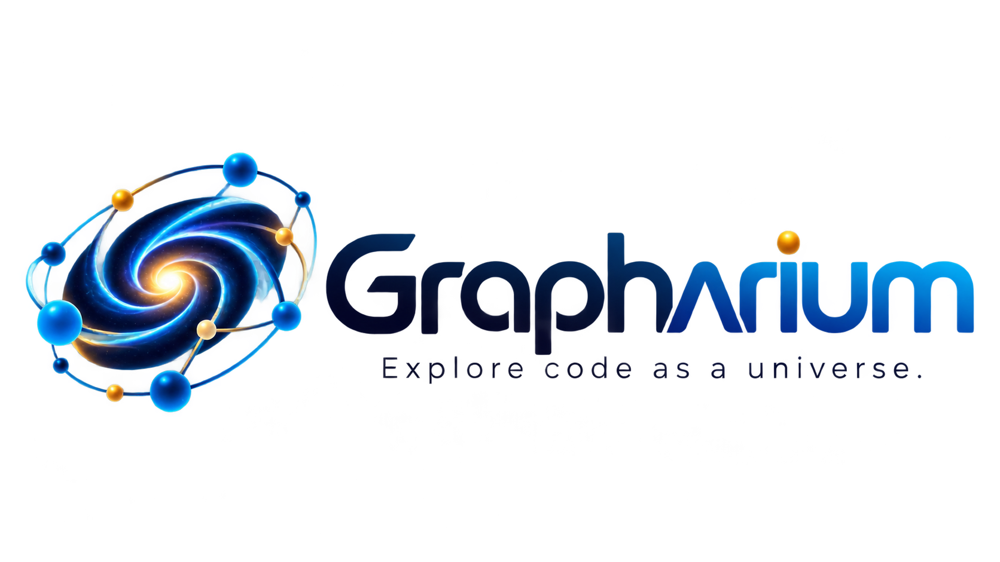
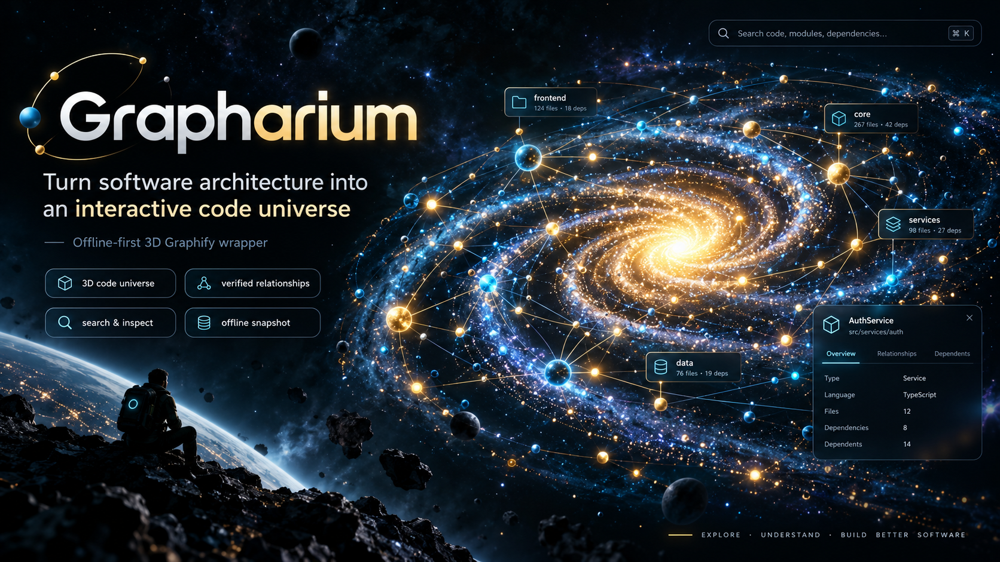

  

<h1 align="center">Grapharium</h1>

<strong>Your codebase, as a universe.</strong>

  Offline-first 3D Graphify wrapper for exploring software architecture as an interactive code universe.

  
  
  
  

  <a href="https://github.com/MakeItEzzz555/grapharium/releases/latest">Download offline demo</a>
  · <a href="#quick-start">Quick start</a>
  · <a href="#one-prompt-setup-for-coding-agents">Agent setup prompt</a>
  · <a href="#documentation">Documentation</a>

  

Visual concept artwork. The actual offline viewer uses its own procedural Three.js interface and may look different.

Grapharium is an offline-first **3D Graphify wrapper**: communities become constellations, files become enclosed systems, functions/classes become stars and planets, and code relationships form luminous connections. Built for precise software architecture inspection.

**Status:** Experimental developer preview. Branding assets, marketing images and screenshots are deferred. Grapharium is not affiliated with upstream Graphify or Three.js.

## Features

- Convert Graphify graph.json to browser-viewable HTML snapshots without a backend, account, external assets, CDN or telemetry.
- Drill from a community universe to individual source symbols, with search and detailed relationship inspection.
- Only EXTRACTED **contains**, **method**, **case_of** and **defines** edges create explicit nesting. Calls, references and inferred edges stay connections.
- Explore reproducible, organically irregular orbital layouts with transparent file-level and nested firmaments.
- Recognize file hubs, stars, planets, moons, events and documents by distinct procedural shapes.
- Render luminous suns with animated plasma shading, procedural coronas and rotating halos; use shared GPU-instanced geometry for bodies and aura links.
- Control galaxy-wide rotation, halo/aura animation, system separation, connection lengths, orbital spread, aura intensity, size contrast, detail depth and quality. Animations pause when the tab is hidden and respect reduced-motion preferences.

**Semantics:** Source-file hubs represent source-path groupings, not proven AST parents. Planet sizes are not real file byte sizes, execution times or source line counts. Graphify's global undirected flag is preserved; typed relations are retained without inventing causal direction.

## Quick start

Requirements: Python 3.9+, a WebGL-capable browser. Node.js 18+ for JavaScript tests.

~~~bash
# In the local checkout, before GitHub publication:
cd ~/Desktop/Graphify-3D
python3 build_viewer.py examples/demo-graph.json
open -a "Brave Browser" Grapharium.html

# Any existing Graphify graph.json:
python3 build_viewer.py /path/to/graphify-out/graph.json
open -a "Brave Browser" Grapharium.html

# Custom output (the Three.js runtime is copied beside it):
python3 build_viewer.py /path/to/graph.json --output /tmp/my-universe.html
~~~

After the GitHub repository is approved and published, you can clone it as MakeItEzzz555/grapharium. The HTML embeds the complete graph and needs the local three.min.js file beside it to run offline.

## One-prompt setup for coding agents

Copy this into Codex, Claude Code, or another local coding agent to set up Grapharium in your own workspace. It performs no remote installation merely by being copied.

> Clone https://github.com/MakeItEzzz555/grapharium into a new local directory after checking that the destination does not already contain user files. Inspect the README, requirements, scripts, and license first. Run the available Python and Node tests without modifying my existing projects. Generate a synthetic demo with python3 build_viewer.py examples/demo-graph.json, verify the generated Grapharium.html and accompanying three.min.js, and open the demo in my browser if available. Summarize how to load my own Graphify graph.json, any missing prerequisites, and test results. Do not upload graph data, overwrite local repositories, or request unnecessary permissions.

For a manual setup, use the commands in [Quick start](#quick-start); this project does not require an installer, secrets, or a hosted service.

## Navigation

| Action | Control |
| --- | --- |
| Rotate | Left-drag, or focus the canvas and use arrow keys |
| Pan | Right-drag or Shift+drag |
| Zoom | Wheel/trackpad, or + / - when the canvas is focused |
| Search across the graph | Search input or / shortcut |
| Inspect | Click any system, star, planet, moon or symbol |
| Return to overview | Universe / Back or Escape (outside search) |
| Recenter | Fit view |
| Save layout options | Export view settings (does not export the embedded graph) |

Hierarchy depth hides complex internals until explored, while selected symbols keep their verified ancestor chain visible. Relation counts in the inspector reflect the graph; the canvas draws a configurable subset for performance.

## The living spiral galaxy

The community overview arranges graph communities across four irregular spiral arms inspired by the pulsing dot/Fibonacci spiral visual direction on 21st.dev. All bodies, links and decorative galaxy dust rotate together as one group, preserving pickability and connectivity. Detail views retain precise symbol positions instead of orbiting connections around unrelated objects. The default overview draws a reduced subset of the strongest community connections; the inspector still retains the complete graph. All graphics are original procedural Three.js implementations—no 21st.dev components, shader assets, or images are copied.

**Inspiration:** https://21st.dev/@easemize/components/spiral-animation

## Visual grammar

| Body | Geometry | Role |
| --- | --- | --- |
| File system | Smooth blue system sphere, golden rotating halo, transparent firmament | Derived source-path hub |
| Star | Smooth luminous sun with plasma shading, radial corona and rotating halo | Root callable/class |
| Planet | Cyan dodecahedron | Explicit child |
| Moon | Violet octahedron | Deeper explicit child |
| Event | Coral cone beacon | Event-like metadata |
| Document | Green rectangular artifact | Documentation/page |
| Other | Grey tetrahedron | Uncategorized symbol |

## Project layout

- **build_viewer.py** — validates and normalizes Graphify JSON, preserves edge provenance and generates offline HTML.
- **hierarchy.js** — validated containment forest, cycle/ambiguity handling, reproducible orbital packing, search and depth LOD.
- **universe.js** — Three.js/WebGL renderer with instanced bodies, aura edges, enclosures, picking, zoom and panning.
- **viewer.js** — search, inspector, controls, selected-node navigation and diagnostics.
- **template.html** — responsive, accessible UI shell.
- **three.min.js** — pinned Three.js 0.158.0 UMD (MIT; see THIRD-PARTY-NOTICES.md).
- **examples/demo-graph.json** — synthetic public-safe example.
- **tests/** — unit and converter regression tests.

## Validate locally

~~~bash
python3 -m unittest discover -s tests -p 'test_*.py' -v
node tests/hierarchy.test.js
node --check hierarchy.js
node --check universe.js
node --check viewer.js
~~~

See **docs/architecture.md**, **docs/visual-design.md**, **docs/roadmap.md**, **CONTRIBUTING.md**, **CHANGELOG.md** and **SECURITY.md**.

## Documentation

- [Architecture](docs/architecture.md)
- [Visual design](docs/visual-design.md)
- [Roadmap](docs/roadmap.md)
- [Changelog](CHANGELOG.md)
- [Contributing](CONTRIBUTING.md)
- [Security policy](SECURITY.md)
- [Third-party license notices](THIRD-PARTY-NOTICES.md)

## Privacy

Graph exports and generated HTML can expose private symbol names, filenames, dependencies and metadata. **Never commit generated snapshots of private repositories.** The generated outputs are gitignored, but inspect staged files before pushing. The browser runs locally with no analytics or network dependency.

## License

Grapharium-authored files are MIT licensed. The bundled Three.js runtime is MIT licensed; its original license appears in **THREE-LICENSE.txt**. An unused legacy 3d-force-graph artifact remains in the original local working folder, but is not part of the new engine.
